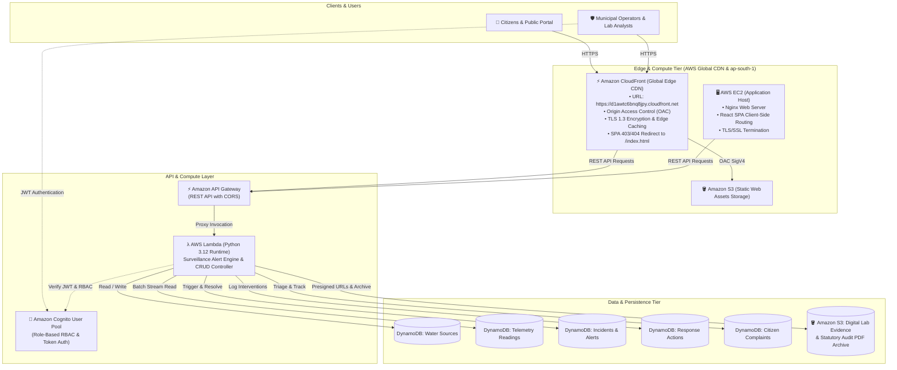

# 🌊 AquaAlert — Municipal Water Quality Surveillance & Emergency Response System

[](https://d1awtc6bnq8jpy.cloudfront.net)
[](https://aws.amazon.com/)
[](https://react.dev/)
[](https://www.typescriptlang.org/)
[](https://vitejs.dev/)
[](https://tailwindcss.com/)
[](https://www.python.org/)
[](https://nginx.org/)
[](https://opensource.org/licenses/MIT)

> **AquaAlert** is an enterprise-grade municipal water quality intelligence, real-time contamination surveillance, and emergency intervention platform built for the **Gwalior Municipal Corporation (GMC)** grid in Madhya Pradesh, India.
>
> The system bridges statutory laboratory compliance (**BIS IS 10500:2012**), IoT telemetry stream processing, public citizen advisories, and field operator incident response pipelines into a unified cloud-native platform.

---

## 🌐 Live Project Deployment

| Platform | Deployment Target | Live URL | Status |
| :--- | :--- | :--- | :--- |
| **Amazon CloudFront (CDN)** | Global Edge Network (TLS 1.3, OAC + S3 Origin) | [**`https://d1awtc6bnq8jpy.cloudfront.net`**](https://d1awtc6bnq8jpy.cloudfront.net) | 🟢 **Live (Production CDN)** |
| **AWS Cloud Infrastructure** | Scalable Multi-Tier Architecture (ap-south-1) | Managed via CloudFront Edge & API Gateway | 🟢 **Active** |

---

## 🏛️ System Architecture

AquaAlert employs a cloud-native, decoupled serverless and containerized architecture designed for maximum fault tolerance, horizontal elasticity, and zero-downtime client-side routing.



---

## 🌟 Key Features

### 1. 👥 Citizen Public Intelligence Portal
* **Real-time Water Quality Index (WQI)**: Ward-level computed health score using weighted arithmetic index methodology.
* **Geospatial Ward Explorer**: Interactive Mapbox / Leaflet mapping showing Tigra Dam transmission aqueducts, secondary feeder lines, treatment plants, and localized water source nodes across all 66 GMC municipal wards.
* **Statutory Parameter Gauges**: Live gauges for **pH**, **Turbidity (NTU)**, **Total Dissolved Solids (TDS ppm)**, **Free Residual Chlorine (mg/L)**, and **Coliform Bacterial Counts**.
* **Public Contamination Advisories**: Instant broadcast warnings (Boil Water notices, Alternate Tanker dispatch alerts, Chlorination flush notices).
* **Public Grievance Redressal**: Citizens can report discoloration, foul odor, pipe bursts, or low pressure with automatic complaint tracking IDs.

### 2. 🛡️ Municipal Operations & Command Center
* **Executive Grid Dashboard**: Live visual breakdown of active alarms, incident severities, parameter violations, and fleet response progress.
* **Water Source Asset Registry**: Complete registry of hand pumps, borewells, overhead tanks (OHT), and Water Treatment Plants (WTP) with GPS coordinates and historical risk ratings.
* **Telemetry Sensor Inspector**: Tabular and graphical inspection of real-time multi-parameter sensor readings with live filtering and verification flags.
* **Incidents & Contamination Alerts Lifecycle**:
  * Anomaly detection against BIS IS 10500:2012 acceptable vs. permissible limits.
  * State transitions: `OPEN` ➔ `INVESTIGATING` ➔ `IN_PROGRESS` ➔ `RESOLVED`.
  * Severity levels: `CRITICAL` (Red Alert), `HIGH`, `WARNING`, `INFO`.
* **Field Response Action Logging & Severity Reclassification**:
  * Operators log field interventions: Shock Chlorination, Mainline Scouring, Booster Dosing, Line Isolation.
  * **Post-Action Severity Reclassification**: Facility operators can downgrade or close alert severities directly following verified remediation.
* **Statutory Compliance & Digital Evidence Archive**:
  * Regulatory audit trail with tamper-proof Amazon S3 document references.
  * Instant dynamic PDF generation and download for lab verification assays and incident investigation dockets.
* **Role-Based Access Control (RBAC)**: Distinct permissions for `Administrator`, `Lab Analyst`, `Field Operator`, and `Viewer`.

---

## 🧪 BIS IS 10500:2012 Compliance Parameter Standards

AquaAlert monitors all municipal sources against the Bureau of Indian Standards drinking water specifications:

| Parameter | Unit | Acceptable Limit | Permissible Limit | Health Hazard on Breach |
| :--- | :--- | :--- | :--- | :--- |
| **pH** | — | **6.5 – 8.5** | No relaxation | Mucous membrane irritation, pipeline corrosion |
| **Turbidity** | NTU | **1.0** | **5.0** | Pathogen shielding, filtration failure |
| **Total Dissolved Solids (TDS)** | mg/L (ppm) | **500** | **2,000** | Gastrointestinal irritation, mineral scaling |
| **Free Residual Chlorine** | mg/L (ppm) | **0.2 – 0.5** | **1.0** | Microbial re-growth (< 0.2), toxic disinfection byproducts (> 1.0) |
| **Nitrate (as NO₃)** | mg/L | **45** | No relaxation | Methemoglobinemia (Blue Baby Syndrome) |
| **Fluoride (as F)** | mg/L | **1.0** | **1.5** | Dental & skeletal fluorosis |
| **Total Coliforms** | MPN/100 mL | **0 (Absent)** | Must not be detectable | Acute bacterial gastroenteritis, cholera, typhoid |

---

## 🛠️ Technology Stack

| Layer | Technologies |
| :--- | :--- |
| **Frontend Framework** | React 18.3, TypeScript 5.5, Vite 6.0 |
| **Styling & Design System** | Tailwind CSS 3.4, Lucide React Icons, PostCSS |
| **Geospatial & Visuals** | Leaflet, Mapbox GL JS, Canvas Confetti |
| **Backend & Compute** | AWS Lambda (Python 3.12, Boto3, REST handler) |
| **API Management** | Amazon API Gateway (HTTP REST API, CORS enabled) |
| **Database & Cache** | Amazon DynamoDB (On-Demand Capacity, Pay-per-request) |
| **Object & Evidence Storage**| Amazon S3 (Encrypted Regulatory Evidence Vault) |
| **Production Server** | AWS EC2 (Ubuntu 24.04 LTS, Nginx 1.24, Systemd, UFW) |
| **Security & Auth** | Amazon Cognito User Pools, OpenSSL (TLS 1.2/1.3) |

---

## 📂 Repository Structure

```
AquaAlert/
├── backend/                         # AWS Serverless Lambda Backend
│   ├── lambda_function.py           # Core Lambda REST API router & DynamoDB controller
│   ├── seed/                        # Demo and seed JSON datasets
│   └── tests/                       # Backend test suite
├── public/                          # Static assets and sample documents
│   ├── images/                      # Water graphics and UI imagery
│   ├── sample-reports/              # Pre-seeded BIS statutory laboratory PDFs
│   └── videos/                      # Dynamic hero video backgrounds
├── scripts/                         # Automation, Seeding & Cloud Deployment Scripts
│   ├── deploy_ec2.py                # Automated Boto3 EC2 VM provisioning
│   ├── ec2_user_data.sh             # EC2 cloud-init deployment & Nginx configuration
│   ├── deploy_s3_cloudfront.py      # Automated S3 sync & CloudFront CDN rollout
│   ├── seed_dynamodb.py             # DynamoDB initial records seeding
│   ├── seed_lab_reports.py          # Lab reports & S3 evidence registration
│   ├── create_and_seed_complaints_resources.py # Complaints table creator
│   └── setup_cognito.py             # Cognito user pool & app client provisioner
├── src/                             # Frontend Source Code
│   ├── api/                         # API Gateway client & pagination utilities
│   ├── components/                  # Modular React component library
│   │   ├── admin/                   # Operations & Command Center tab views:
│   │   │   ├── AdminDashboardView.tsx   # Executive grid KPIs
│   │   │   ├── AlertsIncidentsView.tsx  # Incidents & alerts triage
│   │   │   ├── ComplaintsView.tsx       # Citizen grievance redressal
│   │   │   ├── EvidenceS3View.tsx       # Digital evidence document manager
│   │   │   ├── ReadingsView.tsx         # Telemetry readings table & filters
│   │   │   ├── ReportsView.tsx          # Regulatory reporting & PDF generator
│   │   │   ├── ResponseActionsView.tsx  # Interventions & severity reclassification
│   │   │   ├── RulesThresholdsView.tsx  # Statutory BIS threshold rules
│   │   │   ├── UsersRolesView.tsx       # RBAC administrative users
│   │   │   └── WaterSourcesView.tsx     # Physical water source registry
│   │   ├── alerts/                  # Public alert cards and drawers
│   │   ├── complaints/              # Citizen complaint registration forms
│   │   ├── map/                     # Leaflet / Mapbox ward map explorer
│   │   └── parameters/              # BIS parameter gauges and charts
│   ├── config/                      # Alert severities, constants, and endpoints
│   ├── data/                        # Baseline Gwalior ward GIS coordinates
│   ├── hooks/                       # Custom React hooks (useAdminTablesData, useCognitoAuth)
│   ├── pages/                       # Route pages (HomePage, AdminPage, LoginPage)
│   ├── types/                       # TypeScript interfaces (Water, Alert, Reading, Action)
│   └── utils/                       # Local sync, fallback deduplicators, PDF generators
├── .env.example                     # Environment configuration template
├── package.json                     # NPM dependencies and build scripts
├── tailwind.config.js               # Dark navy municipal theme configuration
└── vite.config.ts                   # Vite bundler configuration & proxy settings
```

---

## 🚀 Local Development Setup

### Prerequisites
* **Node.js**: v18.0.0 or higher
* **npm**: v9.0.0 or higher
* **Python**: 3.10+ *(for backend scripts and seeding)*

### 1. Clone the Repository
```bash
git clone https://github.com/<your-username>/AquaAlert.git
cd AquaAlert
```

### 2. Configure Environment Variables
Copy `.env.example` to `.env`:
```bash
cp .env.example .env
```
Populate `.env` with your endpoints:
```env
# AWS API Gateway REST Base URL
VITE_API_BASE_URL=https://<api-gateway-id>.execute-api.ap-south-1.amazonaws.com/default/

# Optional Mapbox Access Token (defaults to OpenStreetMap if omitted)
VITE_MAPBOX_ACCESS_TOKEN=your_mapbox_public_token_here

# Amazon Cognito Configuration
VITE_COGNITO_USER_POOL_ID=your_cognito_user_pool_id
VITE_COGNITO_CLIENT_ID=your_cognito_app_client_id
VITE_AWS_REGION=ap-south-1
```

### 3. Install Dependencies & Launch Dev Server
```bash
npm install
npm run dev
```
Open **`http://localhost:5173`** in your browser.

---

## 📦 Production Build & Testing

```bash
# Run TypeScript type check and compile production bundle
npm run build

# Preview production build locally
npm run preview
```

---

## ☁️ EC2 Cloud Deployment Guide

To deploy or update AquaAlert on an Ubuntu EC2 instance (`t2.micro` or `t3.micro` Free Tier):

1. **Connect to the EC2 Terminal** via **AWS Systems Manager** or **EC2 Instance Connect**.
2. Run the deployment script:
   ```bash
   git clone https://github.com/<your-username>/AquaAlert.git
   cd AquaAlert
   sudo bash scripts/ec2_user_data.sh
   ```
3. The script automatically:
   * Allocates a 2 GB swapfile to ensure zero memory exhaustion.
   * Fetches the production bundle or builds locally.
   * Generates a TLS certificate for **Port 443 (HTTPS)**.
   * Configures **Nginx** with client-side SPA fallback routing (`try_files $uri $uri/ /index.html`).
   * Opens firewall ports `80` & `443` and starts Nginx.

---

## 📜 License & Acknowledgments

This project is licensed under the **MIT License** — see the [LICENSE](LICENSE) file for details.

Developed for **Municipal Water Quality Surveillance & Public Safety** under the statutory guidelines of the **Bureau of Indian Standards (BIS IS 10500:2012)** and **Jal Jeevan Mission (JJM)**.
